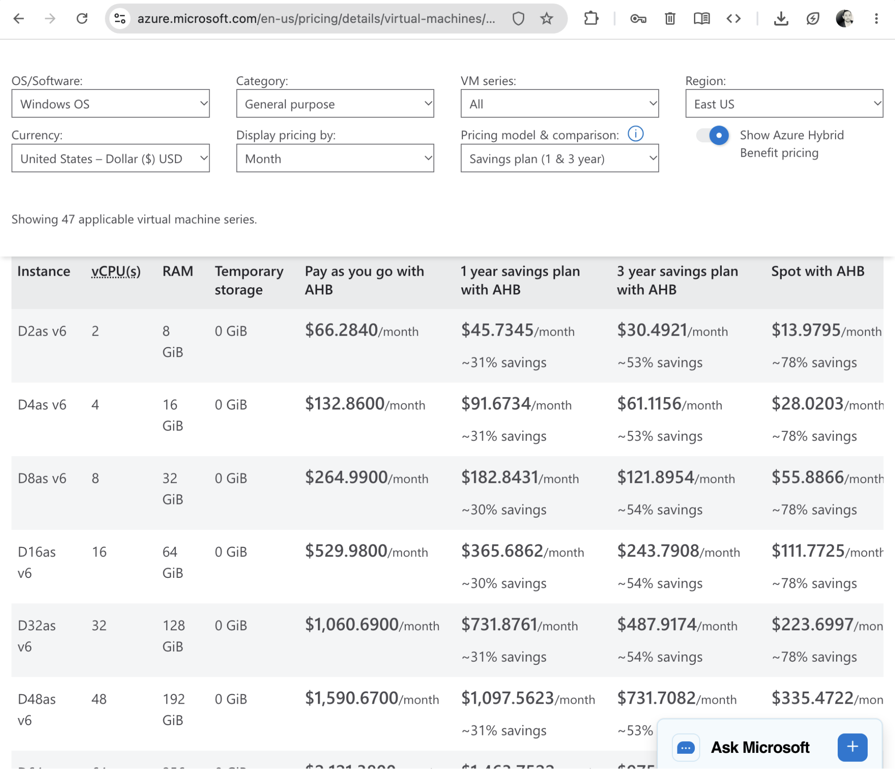
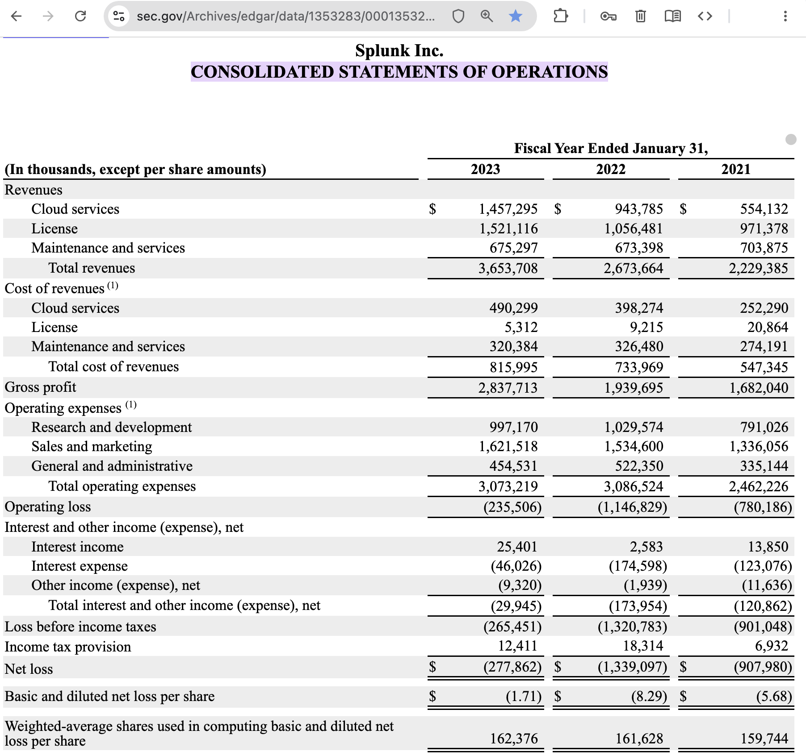
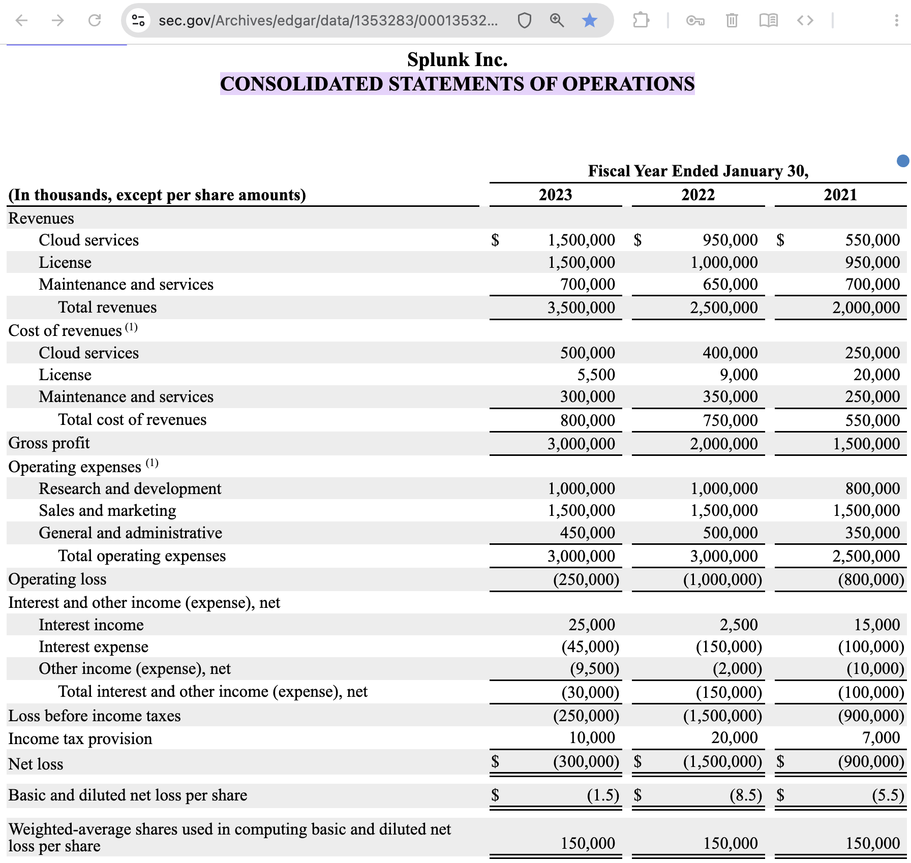
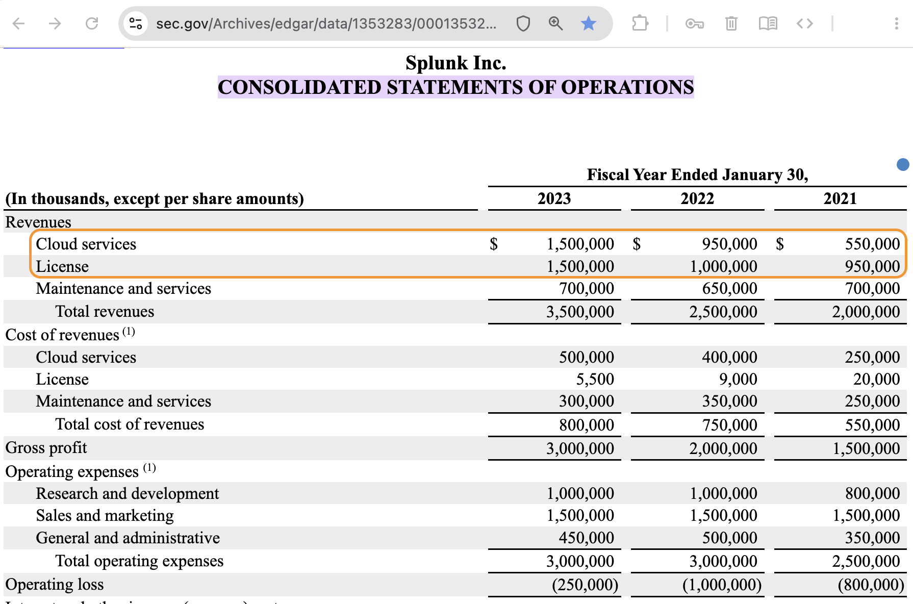
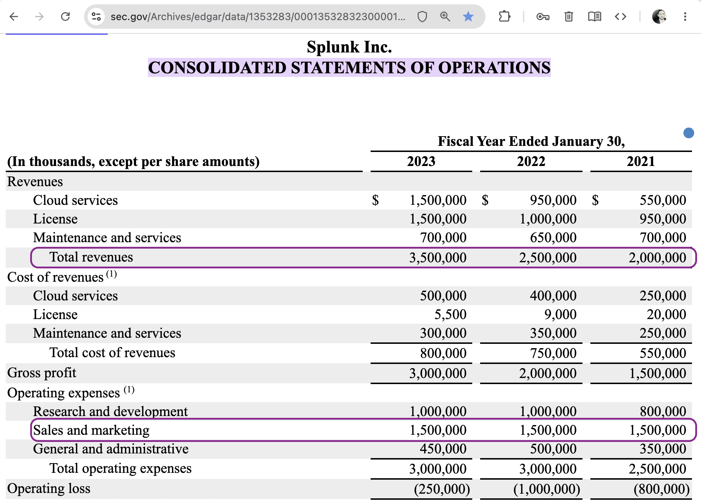
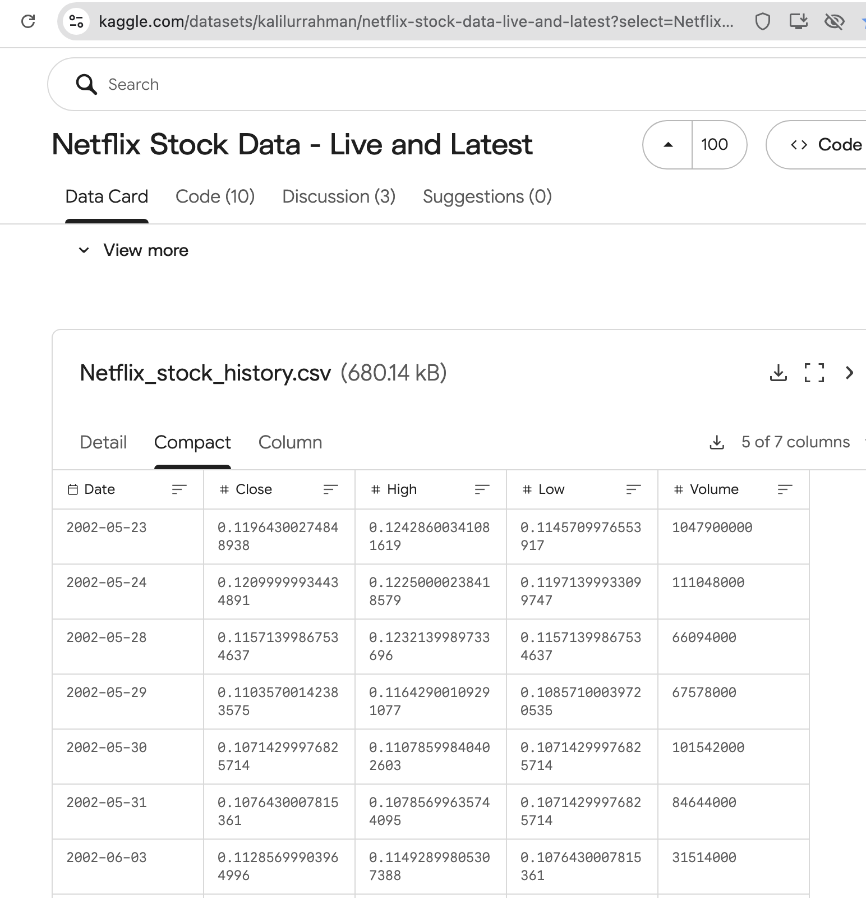
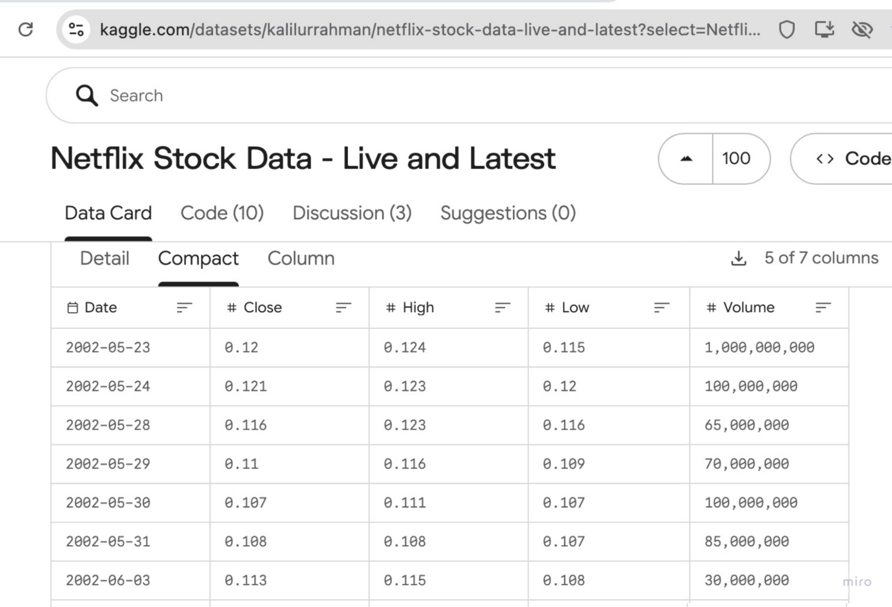
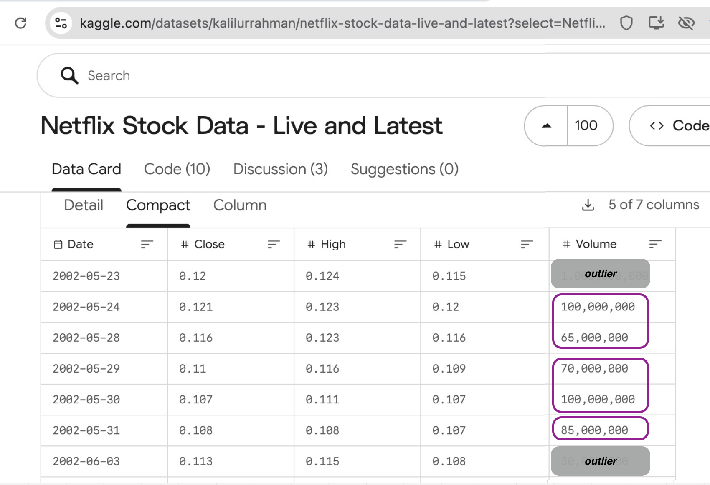

# Make data readable

Data can tell rich stories, but sometimes the numbers get in the way.

This library makes data more readable, helping us see the patterns that allow us to read the stories it contains.

## Implementations

| Platform | Location | Install |
| --- | --- | --- |
| Google Sheets | [js/](./js/) | [Copy template](https://docs.google.com/spreadsheets/d/1GdHvYk3dVzJErrGH7yDULW6srM0gaHeYMGMn3k0-GY4) |
| Python | [python/](./python/) | `pip install dynamic-rounding` |
| Chrome Extension | [chrome-extension/](./chrome-extension/) | [Load unpacked](https://developer.chrome.com/docs/extensions/mv3/getstarted/development-basics/#load-unpacked) |

## Quick Examples

### Chrome Extension

[1 minute video demo](https://share.descript.com/view/Y76MAoqM06p)

The extension rounds numbers *in place* on any web page.

In other words, you do not have to copy a table and paste it into a spreadsheet to simplify it. You can visit your existing database, website, or SaaS tool and see simplified numbers that make the story easier to grasp.

### Google Sheets

A spreadsheet is one of the best tools for quickly exploring data. This library includes a custom function that can **declaratively simplify** an entire dataset.  

- `=ROUND_DYNAMIC(87054321)` → 85,000,000
- `=ROUND_DYNAMIC(A1:A10)` → rounds the whole dataset

The defaults handle most cases, and advanced users can tweak its output to put different ‘lenses’ on the data, to look at it in ways that their specific situation calls for.

### Python

#### Simple python:

Data professionals may explore their data with python libraries.

- `from dynamic_rounding import round_dynamic`
- Single value: `round_dynamic(87054321)` → 85,000,000
- Dataset: `round_dynamic([4428910, 983321, 42109])` → \[4,500,000, 1,000,000, 40,000\]

#### with pandas:

- `from dynamic_rounding.pandas import round_dynamic_series`
- Entire series:  `round_dynamic_series(df['revenue'])`

---
## Example: Splunk
Most data I see has one thing in common — it's nearly impossible to understand.

Who knows this the best?  The people who design pricing pages. 

For example, one of these options costs about 11 times more than the cheapest option, and double the next closest. Can you tell which is which?  

 
     
    

You probably can't, at least not easily.  What these designers understand is that our working memory is limited.

  

*https\://pageperson.org/blog/cognitive-load-on-pricing-pages-patterns-that-confuse-buyers/*

Cognitive psychologist George Miller famously found that humans can hold at most 6 or 7 things in our head at once.  

 

If working memory maxes out at about seven items, **what chance do we have** at understanding even this one table that has more than 50 numbers ***each*** bigger than 6 or 7 digits?  

  

*NB: this table is one of 127 pages of text and data ( [source](https://www.sec.gov/Archives/edgar/data/1353283/000135328323000011/splk-20230131.htm) )*

Look at it for a few seconds \- can you read the company’s story from it?  
If not, don’t blame yourself. **It’s not you.**  This is an impossible task.  
And it’s a shame because this is good data.  It tells a comprehensive story of Splunk’s past, present, and future, if only we could read it.  
Fortunately, we can fix this.

#### **Step 1: Simplify the numbers**

This is the same data but with **80%** fewer numbers.  

#### Now that we can see the *numbers*, let’s look for *patterns*.

#### **Step 2: Patterns**

The first two lines already reveal interesting patterns:

- Splunk has **2 service lines** \*\*  
- One grew by **300%**; the other grew less than **50%**   
- The *faster-growing* service is the *smaller* of the two

\*\**note: excludes maintenance, which typically sits under licenses.*

Can you see it now?   

<\p>

Another pattern: each year Splunk spends \$1.5B to grow revenue by \$0.5B \- \$1B.   

Aside: Why not just ask Claude for the patterns?  
You could, but that *replaces* your thinking. Simplifying the data *accelerates* you.  Simplifying the data lets you see the patterns yourself, before you analyze it (with or without AI).

#### **Step 3: Assemble the story**

Humans seek meaning. Spot a pattern, and your brain immediately builds a story to explain it.

If these are the patterns we read out of the financial statements… 

- Revenue transitioning from on-prem to SaaS  
- Cost of sales far exceeding new revenue

… then they suggest a larger story:

- **Disruption**: industry-wide disruption by SaaS  
- **Changing customer:** who used to reason about *data centers* but are realizing they only need some *good networking* to reach cloud services …   
- **Sales effectiveness**: a scale-up still buying growth in a contested industry

Notice how much story has been pulled out *and the analysis hasn’t even started yet*.  We read it right out of raw data.  

Here is how Splunk’s story unfolded:  In 2024, it was acquired at a stunning premium

* by a leading **networking** company (Cisco)  
* who went all-in on the SaaS division (shutting down the licenses division) …   
* and launched a sales campaign to target its own customers, adding over ***one thousand*** new enterprise customers in the first year to the Splunk division/

That is the story of Splunk, and that story was in the 2023 financial statements. 

Simplifying the data made it available to our eyes without modelling or using AI, or any tool beyond our own eyes and brains. 

### Why a Chrome extension?

Readable Data makes this practical.

The extension works where you already encounter data: in your browser.

It adds a small dot to data inside pages you load. Click the dot and the extension simplifies the data in place—not in a separate spreadsheet or a different interface.

You do not have to copy a table and paste it into a spreadsheet to simplify it. You can visit your existing database, website, or SaaS tool and see simplified numbers that make the story easier to grasp.

You can effectively paste a spreadsheet into your browser.

The extension also works with data that mixes numbers with words, symbols, and currencies. Sometimes making data human-readable means throwing away numbers. Sometimes it means formatting them so we can see them more clearly.

### Try it yourself

#### This is Netflix's first week of trading data. 

#### Find the outliers

Take 3 seconds to find the outliers in the ‘volume’ column.

<\p>

[*source*](https://www.kaggle.com/datasets/kalilurrahman/netflix-stock-data-live-and-latest?select=Netflix_stock_history.csv)

Now try it on simplified data. 

The first value (\~ 1 B) is roughly ten times the next day's value, and the final value (30 mm) is also an outlier.

#### Find the average trading volume

Excluding the outliers, what was Netflix's average trading volume that week?

If you don’t like spoilers, take a few more seconds before reading the next line.

<\p>

It is about 85 million.

Not many of us could, just by looking at the original table, have been able to see as much in it.

## License

MIT
