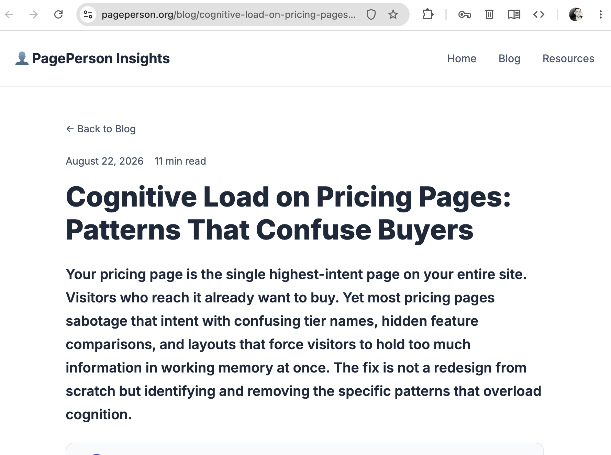
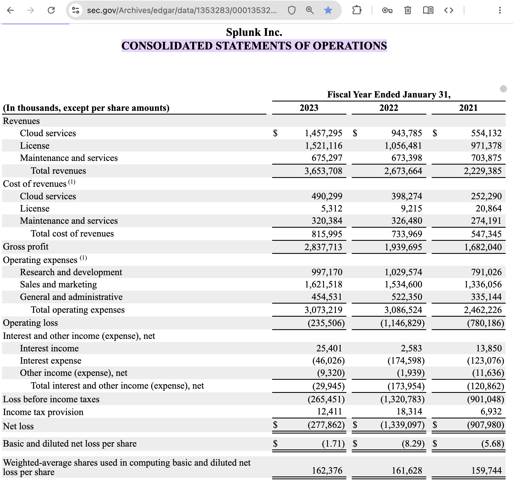
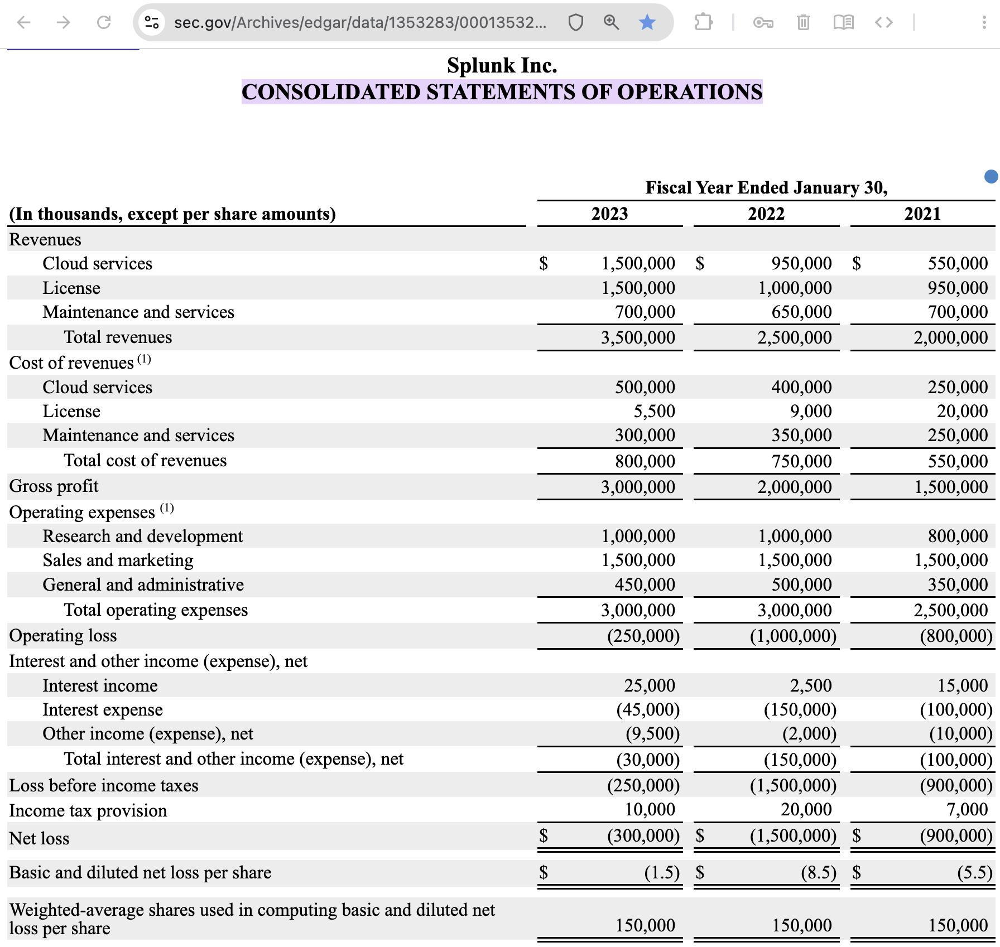
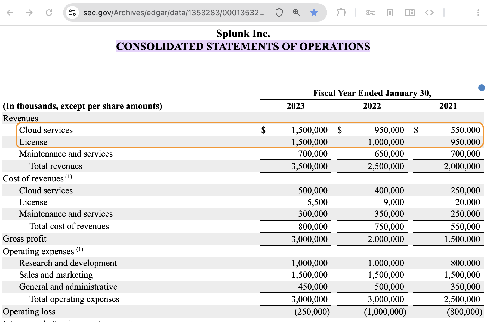
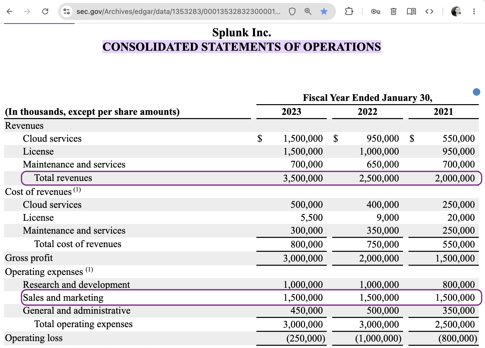
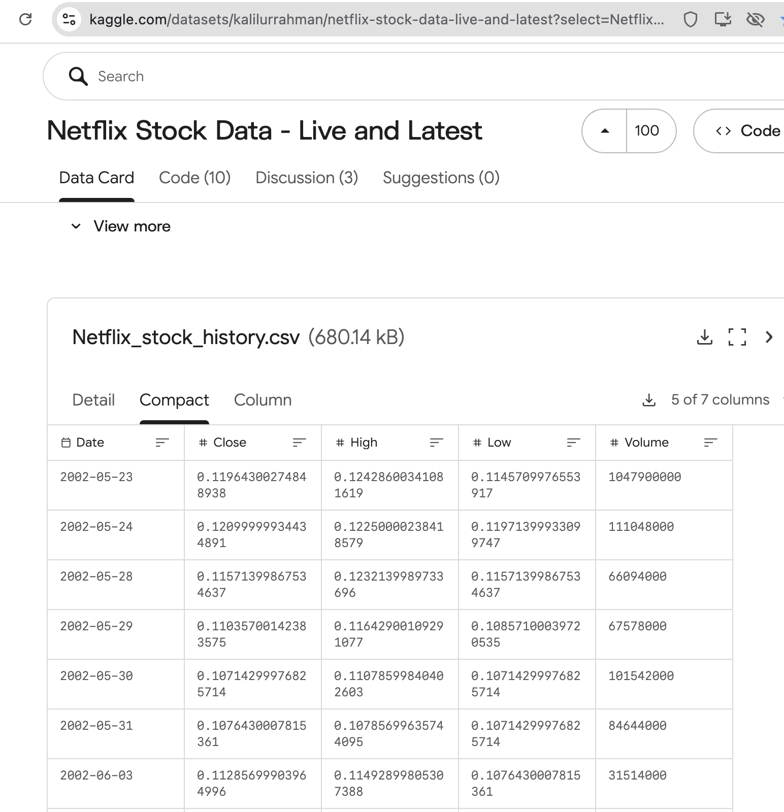
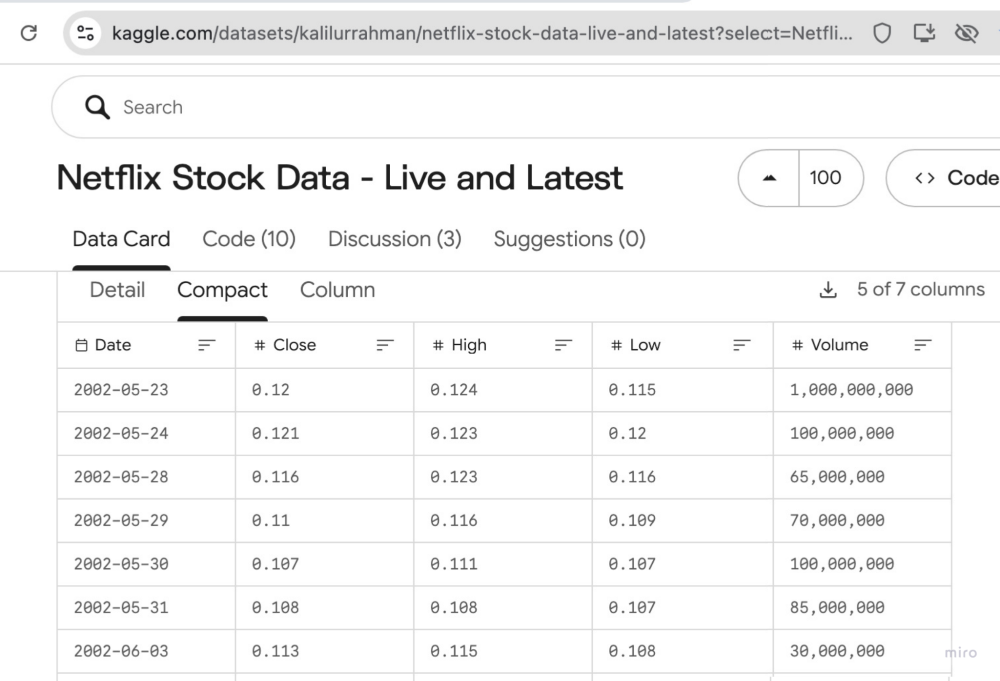
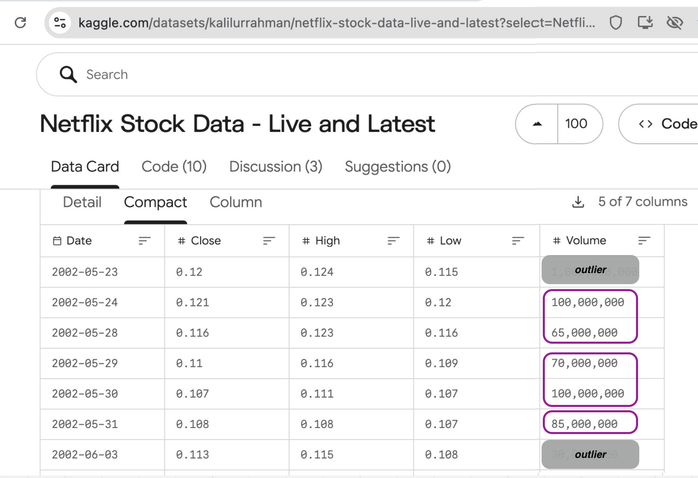

# Make data readable

Data can tell rich stories, but sometimes the numbers get in the way.

This tool makes data easier to read, letting us see the stories within.

[1 minute video demo](https://share.descript.com/view/Y76MAoqM06p)

It works where you do - in your browser, AI chats, and spreadsheets.  It simplifies numbers - *in place* - as you browse, read email, use tools or chat with LLMs.

The intention is to enrich your experience without adding any mental load - you do the same activities but get more out of them.

| Platform | Adds the ability to simplify: |
| --- | --- |
| Google Sheets | * entire ranges   * mixed number/text cells   * cells containing multiple numbers |
| Chrome Extension | * while browsing (vs. pasting into a spreadsheet or LLM)   * dates and times |
| Claude Code | * tables in the terminal or App |
| Python | * dataframes (native or pandas) |

  
# Why make data readable? 
Most data I see has one thing in common — it's nearly impossible to understand.

Who knows this the best?  The people who design pricing pages. 

 

<em> Can you tell at a glance which of these options costs 11x more than the other?</em> 

You probably can't, at least not easily, even though the data is there.  What these designers understand is that our working memory is limited.

 

<em> https://pageperson.org/blog/cognitive-load-on-pricing-pages-patterns-that-confuse-buyers/</em> 

Cognitive psychologist George Miller found that humans can hold at most 6 or 7 things in our head at once.  

 

  
So if working memory maxes out at about seven items, **what chance do we have** at understanding this?

 

<em> This table contains over 50 numbers that are <u><b>each</b></u> bigger than 6 or 7 digits.    It is just one of <u><b>127 pages</b></u> of that year's financial statements. </em> 

It's a shame because this is good data - it contains the story of Splunk’s past, present, and future. Spend a few seconds looking at it - can you see Splunk's story?

If not, don’t blame yourself. **It’s not you.**  It's an impossible task. 

Let's fix that.

### **Step 1: Simplify the numbers**
This is the same data but with **80% fewer numbers**.  The Chrome extension simplified this inside the SEC.gov website.

 

### **Step 2: Patterns**
Now that we can see the *numbers*, let’s look for *patterns*.

The very first two lines are already revealing.  If you like, look at those 2 lines before you continue.

Here's what I see:
- Splunk has **2 service lines** \*\*  
- One grew by **300%**; the other grew less than **50%**   
- The faster-growing service is still the **smaller** of the two

\*\**excluding maintenance, which is anyways typically part of licenses.*

Can you see that?   

 

  

**A second pattern**: each year Splunk spends \$1.5B to grow revenue by \$0.5B \- \$1B. 

 

### **Step 3: Assemble the story**

Humans are meaning-seeking machines.  Stories emerge - sometimes unconsciously - to explain what our brains have noticed.

So if these are the patterns we read...
- Revenue transitioning from on-prem to SaaS  
- Cost of sales far exceeding new revenue  

… then these are the stories that emerge:
- **Disruption**: industry-wide disruption by SaaS  
- **Changing customer:** who used to reason about *data centers* but are realizing they only need *good networking* to reach cloud services …   
- **Sales effectiveness**: a scale-up still buying growth as it *struggles to scale* in a contested industry

### Was that the *right* story?
Here is how Splunk’s story unfolded: These results are from 2023.  In 2024 it was acquired at a stunning premium:

* by a leading **networking** company 
* who went all-in on the SaaS division (shutting down the licenses division) …   
* and launched a sales campaign to target its own customers, adding over ***one thousand*** new enterprise customers in the first year to the Splunk division.

That is the story of Splunk, and that story was available to read from the 2023 financial statements without any external tools.

Think about how many things come at you every day.  The ability to see one level deeper, even into some of them, can be game changing.

> As an aside: You may be wondering - why not just ask Claude to read and interpret this data?
> You could, and maybe you should.  But think about it this way: 
> - notice how much story has been pulled out *and the analysis hasn’t even started yet*.  Simplifying the data lets you see the patterns *before* you analyze it (with or without AI).
> - Pasting it into an LLM *replaces* you; this *accelerates* you. Your knowledge and experience are the only way to get differentiated insight.

## Try it yourself

Let's put it to the test - you do this one. 
This is Netflix's first week of trading data. Most of us don't handle data this complex, so let's see if the tool can work here for you, and if so it may be meaningful for your more typical tasks.

### Task 1: Spot the outliers

Take 3-5 seconds to identify the outliers in the ‘volume’ column.

 

<em> https://www.kaggle.com/datasets/kalilurrahman/netflix-stock-data-live-and-latest?select=Netflix_stock_history.csv</em> 

Confident in your choice?  Now try it on simplified data. 

 

 **Answer**: The outliers are the first and last values.  On its first day after going public, \~1 B shares of Netflix traded.  This went up and down until the 7th day when only 30mm traded.

### Task 2: Average trading volume

Excluding the outliers, what was Netflix's average trading volume that week?  Take a few seconds to look at the picture above and see if you can figure it out just by looking.
  

 

 **Answer**: The average trading volume in the first 7 days (excluding the outliers) was ~85 million.

Look at the original table again. Even now, when we already know the answer, its *still* hard to see.  

 

  
This simple tool helps us unlock insights by working with us, amplifying the way we naturally explore and understand data.

## Quick Examples

### Platform 1. Google Sheets

This library includes a custom Google Sheets function for easily simplifying data.

- `=ROUND_DYNAMIC(87054321)` → 85,000,000
- `=ROUND_DYNAMIC(A1:A10)` → rounds the whole dataset 

The defaults handle most cases, and advanced users can tweak its output to put different ‘lenses’ on the data.

### Platform 2. Chrome Extension

[1 minute video demo](https://share.descript.com/view/Y76MAoqM06p)

The extension works where you do - in your browser.  It simplifies numbers - *in place* - as you browse, read email, use tools or chat with LLMs.

If you do come across data you want to understand better, instead of you pasting data from a browser into a spreadsheet, the Chrome extension effectively pastes a spreadsheet into your browser.

The intention is to enrich your experience without adding any mental load - you do the same activities but get more out of them.
### Platform 3. Python
#### 3a. Simple python
Data professionals may explore their data with python libraries.

- `from dynamic_rounding import round_dynamic`
- Single value: `round_dynamic(87054321)` → 85,000,000
- Dataset: `round_dynamic([4428910, 983321, 42109])` → \[4,500,000, 1,000,000, 40,000\]

#### 3b. pandas
- `from dynamic_rounding.pandas import round_dynamic_series`
- Entire series:  `round_dynamic_series(df['revenue'])`

### Platform 4. Claude Code plugin

The plugin simplifies the numbers in the markdown tables of a Claude Code session, in place, in the transcript.

- Install, in a terminal: `claude plugin install dynamic-rounding --marketplace ArieFisher/dynamic-rounding`
- Run `/simplify-data` to turn it on, and again to turn it off
- The model's reply stays as written: the plugin changes only what the transcript shows

## Implementations
| Platform | Install | Code |
| --- | --- | --- |
| Google Sheets | [Copy template](https://docs.google.com/spreadsheets/d/1GdHvYk3dVzJErrGH7yDULW6srM0gaHeYMGMn3k0-GY4) | [js/](./js/) |
| Chrome Extension | [Load unpacked](https://developer.chrome.com/docs/extensions/mv3/getstarted/development-basics/#load-unpacked) | [chrome-extension/](./chrome-extension/) |
| Claude Code | `claude plugin install dynamic-rounding --marketplace ArieFisher/dynamic-rounding` | [claude-code-plugin/](./claude-code-plugin/) |
| Python | `pip install dynamic-rounding` | [python/](./python/) |

## License

MIT
