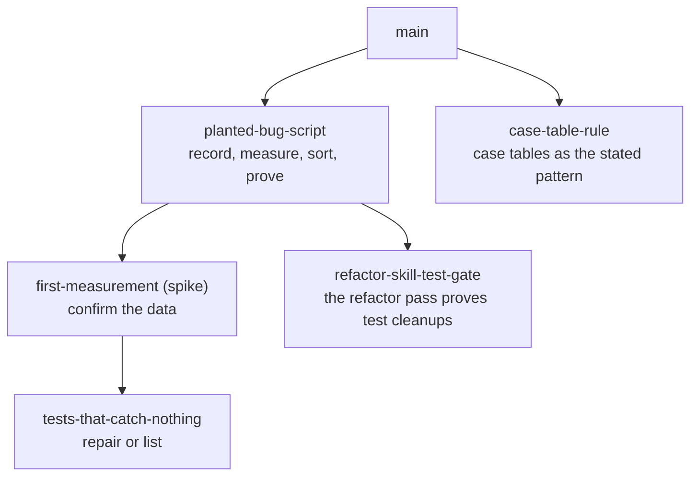

# Sprint Plan: Trim the extension tests without weakening them

**Status:** PROPOSED
**Created:** 2026-11-27
**Base branch:** main (d38a0ce)
**Slug:** test-dedup

## Context

The extension suite holds 4,623 assertions in about 26,000 lines of test pieces. Some assertions repeat others, and some pass whatever the code does: #824 found three of them in one test piece. Today the only proof that a cleanup of a test piece lost nothing is an agent reading the tests, because the suite cannot check itself: a cleanup that deletes or weakens an assertion still passes.

Outcome: a script measures which planted bugs each assertion catches. That measurement finds assertions that catch nothing, finds assertions that only repeat others, and proves that a change to the test pieces leaves every planted bug caught. The refactor pass uses the proof as its gate for test pieces.

Terms used below, added to `docs/vocabulary.md` in sprint 1:
- **Planted bug.** One small deliberate change to the product code, such as `<` to `<=` or `true` to `false`, made by the script and reverted after one suite run. Not "mutant".
- **Catch.** An assertion catches a planted bug when it fails while that bug is in the code.
- **Catch list.** The planted bugs one assertion catches.
- **Case table.** A list of rows, each holding an input and its expected result, that one test loops over with one setup.

## 1. Repo Survey

- **Languages.** JavaScript for the extension, the Sheets library, and the Claude Code plugin; Python for `python/`. No package file at the repository root and no installed packages; every script runs on Node alone.
- **The extension suite** (checked on `main` at d38a0ce):
  - The runner joins the test pieces in its order list and runs them as one script (`chrome-extension/tests.js`). It maps stack frames back to a piece and line (`mapToPieces`).
  - Setup reads every product file from disk, relative to the extension folder, through the manifest's content script list (`chrome-extension/tests/setup.js:72-79`). Some pieces also read `js/`, `docs/`, and `sidebar.html`, so a run needs the whole repository tree, not only the extension folder.
  - `eq(name, actual, expected)` (`setup.js:277`) is the one assertion function, with one exception: `sidebar-tests.js:523-547` changes the pass and fail counts directly.
  - 3,282 `eq(` call sites give 4,623 assertions at run time, because case tables run one call site per row.
  - One run takes 6.7 seconds of wall time and 2.2 seconds of processor time, measured on 2026-11-27. The computer has 8 cores.
- **Test pieces by size** (lines): detection 5,355; rounding pass 4,739; helpers 3,874; pillbox 2,855; controller 2,549; source checks 2,472; sidebar 2,055; number 1,904; capture log 1,372; table registration 1,286; ladder 694; bus 570; table step 356; setup 299; table kinds 292.
- **Product code under test:** about 7,000 lines in `chrome-extension/` outside `tests/`.
- **Case tables already exist** in the number, detection, and rounding pass pieces (for example `CLOCK_TIME_CASES`, `number-tests.js:462`).
- **The refactor skill** (`.agent/skills/refactor/SKILL.md`) runs a find subagent and an action subagent per file. Its action subagent reverts a cleanup when a suite fails, which proves nothing for a cleanup to a test piece.

## 2. Repo Conventions

- **Version files.** `chrome-extension/manifest.json`, `claude-code-plugin/.claude-plugin/plugin.json`, `js/src/entry.js` (its `[VERSION]` line), `python/pyproject.toml`. `scripts/bump-versions.py` holds the table.
- **Version bump policy.** `merge-workflow` (`.github/workflows/bump-version.yml`). Sprint branches never touch version files.
- **Test command.** `node chrome-extension/tests.js && node js/tests.js && node js/doc-tests.js && node claude-code-plugin/tests.js && node scripts/build-sheets.js --check`
- **Gate command.** `scripts/check-files.sh --staged && scripts/check-vocab.sh --staged`
- **Build command.** `node scripts/build-sheets.js`; no sprint here changes a shared library file.
- **Branch naming.** Change-type prefixes: `feature/`, `fix/`, `refactor/`, `docs/`, `chore/`, `plan/`.
- **Dependent policy.** `after-merge`. CI runs only on pull requests based on `main`.
- **Base branch writes.** `pull-request`.
- **Commit convention.** Conventional Commits.
- **PR rules.** `AGENTS.md`, "Text on GitHub".

## 3. Design

### 3.1 An assertion is identified by its piece, line, and name

**What.** When the runner receives a record path, `eq` records each assertion's result with its call site's stack frame, and the runner writes one JSON file at process exit: `{ piece, line, name, passed }` per assertion, the piece and line mapped through `mapToPieces`. The direct count changes in the sidebar piece become `eq` calls.

**Why.** A name alone can repeat, and a line alone repeats in a case table. Together they identify one row of one table. The runner already maps lines to pieces, so the script reads the record and never parses test text (Minimize design-time coupling; AGENTS.md "Collapse a path before opening a second one").

**Alternatives.** Parsing the failure list the report prints gives failures only, not the full list of assertions, so an assertion that catches nothing would not appear.

### 3.2 Planted bugs come from a small lexer and a fixed list of changes

**What.** The script reads each product file, skips comments, string text, and template text with a small lexer, and makes one planted bug per match of a fixed list: comparison operators (`<`↔`<=`, `>`↔`>=`, `===`↔`!==`), `&&`↔`||`, `true`↔`false`, a leading `!` removed, a number literal `n` to `n + 1`, and an `if` condition forced to `true` and to `false`. The list lives in the script as one table. A planted bug that stops the suite before its first assertion is invalid and is counted, not used.

**Why.** No install, and a planted bug the lexer misjudges fails safely as invalid (Simple components).

**Alternatives.** A JavaScript parser package needs an install and the repository's first package file. Stryker with this suite's own runner reports a pass or fail per run, not per assertion.

### 3.3 Each planted bug has one of four outcomes

1. **Caught by assertions:** one or more assertions fail; their identities form the catch.
2. **Caught by a crash:** the suite stops with an uncaught error. No assertion is credited.
3. **Caught by a timeout:** the run exceeds the time cap (section Simplicity, item 5). No assertion is credited.
4. **Not caught.**

Outcomes 2 and 3 count as caught in a proof but credit no assertion, so they never make an assertion look unique.

### 3.4 Runs happen in worker copies outside the repository

**What.** The script creates one git worktree per worker in the operating system's temporary folder, at the commit under measurement, and removes them at the end. Each worker writes its planted bug into its own copy.

**Why.** The suite reads files across the repository, so a copy of the extension folder alone fails. Worktrees keep the user's checkout untouched while a run lasts hours (Segregate by characteristics).

### 3.5 Three modes in one script

- **measure** `--commit <sha> --out <file>`: runs the clean suite three times, then every planted bug, and writes the result file: the commit, the planted bug list, each planted bug's outcome, and each assertion's catch list.
- **sort** `--in <file>`: prints three lists by piece:
  - **catches nothing** (and not flaky);
  - **repeats others:** the script walks assertions in order-list order, then line order, and drops an assertion when every planted bug it catches is still caught by a kept assertion; each drop updates the kept set before the next test, so two assertions that only repeat each other never both drop;
  - **unique:** every other assertion.
- **prove** `--in <file> --branch <ref>`: fails unless every planted bug caught in the result file is still caught on the branch. It reruns only the planted bugs whose crediting assertions all sit in pieces the branch changed. A branch that changes the setup piece, the helpers piece, or the runner reruns every planted bug. A branch that changes product code fails at once with "measure again", because its planted bugs differ.

**Why one script.** The three modes share the planted bug list, the worker copies, and the result file; three scripts would copy them (AGENTS.md "Group like concepts into a single location").

**Why the rerun set is enough.** On a branch that changes only test pieces, an assertion in an unchanged piece runs unchanged code against unchanged product code, so its catches hold.

### 3.6 Results are files, not commits

The result file goes where `--out` points; nothing enters the repository. A result file holds the commit it measured, and `prove` fails on a result file whose product code differs from the branch's.

## 4. Sprint List & Dependency Graph

### Sprint List

| Wave | Sprint | Goal | Depends on |
| --- | --- | --- | --- |
| 1 | `planted-bug-script` | The runner records every assertion; the script measures, sorts, and proves. | none |
| 1 | `case-table-rule` | Case tables become the stated pattern for input-and-result tests. | none |
| 2 | `first-measurement` (spike) | Measure `main` and confirm the data can drive the trimming. | `planted-bug-script` |
| 2 | `refactor-skill-test-gate` | The refactor pass proves every cleanup to a test piece with the script. | `planted-bug-script` |
| 3 | `tests-that-catch-nothing` | Every assertion that catches nothing is repaired or listed for the product manager. | `first-measurement` |

The trimming itself runs as refactor passes over test pieces, after `refactor-skill-test-gate` merges (section 7). The refactor skill already creates its own branch and pull request, so a sprint that wraps it would open a second path.

**Why this order.** The gate sprint needs only the script, so it runs beside the spike. The repair sprint needs the spike's list. The case table rule needs nothing.

### Dependency Graph

## 5. Sprint Definitions

### planted-bug-script

- **Branch:** `chore/planted-bug-script`
- **Goal:** The runner records every assertion, and one script measures, sorts, and proves as section 3 states.
- **Scope:**
  - Runner and `eq`: the record mode in section 3.1. The sidebar piece's direct count changes become `eq` calls.
  - `scripts/planted-bugs.js`: the lexer, the planted bug table, worker copies, the four outcomes, the three modes, the caps in the Simplicity section.
  - `scripts/planted-bugs-test.js`: runs the script on a synthetic product file and a synthetic suite of a few assertions, with a known answer for every mode. It runs in seconds and joins the test command.
  - Docs (`docs:` commit): the four terms in the Context section go into `docs/vocabulary.md`, "Working terms"; `CONTRIBUTING.md` gains how to run the three modes.
- **Out of scope:** the Sheets, plugin, and Python suites; any change to a test piece beyond the sidebar count changes.
- **Acceptance criteria:**
  - On the synthetic fixture, `measure` gives the known catch lists, `sort` gives the known three lists, and `prove` fails on a branch that deletes a unique assertion and passes on one that deletes a repeating assertion.
  - A planted bug that loops forever stops at the time cap and counts as caught by a timeout.
  - `prove` fails with "measure again" on a branch that changes product code.
  - The extension suite still reports 4,623 assertions, with and without a record path.
- **Depends on:** none.
- **Complexity:** L.
- **Dev notes:**
  - Write the record at process exit, so an assertion that runs after a timer is recorded.
  - Named constants: `CLEAN_RUNS = 3`, `TIME_CAP_MULTIPLE = 3`, `MAX_PLANTED_BUGS = 10000`, in the script.
  - Skip `js/round_dynamic.js` and `claude-code-plugin/hooks/library.js`; plant bugs only in `chrome-extension/` outside `tests/`.

### case-table-rule

- **Branch:** `docs/case-table-rule`
- **Goal:** `AGENTS.md` states that tests differing only by input and expected result share one case table per setup.
- **Scope:** one rule under "Code style" in `AGENTS.md`; "case table" in `docs/vocabulary.md` if sprint 1 has not merged, else no vocabulary change.
- **Out of scope:** converting any test.
- **Acceptance criteria:**
  - The rule names when a case table applies (one function, one setup) and when it does not (event order, sequences, code-text checks).
  - The gate command passes.
- **Depends on:** none (decision 1).
- **Complexity:** S.
- **Dev notes:** a rule goes in one place; the refactor skill points at it, never restates it.

### first-measurement (spike)

- **Goal:** Answer whether the planted bug data is good enough to drive the trimming (decision 2 settles that the trimming runs). `tests-that-catch-nothing` and the trimming passes depend on the answer.
- **Branch:** none. Findings go in `docs/sprint-logs/test-dedup-first-measurement.md`, committed on its own `docs/` branch.
- **Investigate:**
  - Planted bugs: total, invalid, and the share of each outcome in section 3.3.
  - Assertions per piece: catches nothing, repeats others, unique.
  - Flaky assertions from the three clean runs, and assertion identities that repeat.
  - Elapsed time of the run.
- **Out of scope:** any change to code or tests.
- **Acceptance criteria:**
  - Each number above recorded.
  - A verdict on the data: if crashes and timeouts credit no assertion for most caught planted bugs, the "repeats others" list is too thin to act on, and the plan needs a revision.
- **Depends on:** `planted-bug-script`.
- **Complexity:** S.
- **Dev notes:** the run takes hours (an estimate); start it in the background. A negative verdict leads to a new plan revision, not an edit to this one.

### refactor-skill-test-gate

- **Branch:** `chore/refactor-skill-test-gate`
- **Goal:** A refactor pass over a test piece keeps every planted bug caught.
- **Scope:** `.agent/skills/refactor/SKILL.md`:
  - Main agent: when the input holds a test piece, it runs `measure` on the run's start commit in the background at step 1, and `sort` before the first find subagent for a test piece.
  - Find subagent: for a test piece, it reads that piece's three lists. An assertion that repeats others is a Group A finding to drop. Exception (decision 3): when its name, comment, or test group heading points to a past bug or issue, it stays, unless a kept assertion checks the exact same input; then it is a Group A drop too. Merging tests into a case table is Group A only when `AGENTS.md` holds the case table rule. An assertion that catches nothing is a defect on main.
  - Action subagent: after each cleanup to a test piece, it runs `prove` and reverts the cleanup on a failure.
  - Review subagent: it runs `prove` on the branch and reports a failure as a defect in the branch's own changes.
- **Out of scope:** running a pass; any test piece.
- **Acceptance criteria:**
  - Every step names the mode it runs and what a failure leads to.
  - No rule from `AGENTS.md` is restated; the skill points at it.
- **Depends on:** `planted-bug-script`.
- **Complexity:** M.
- **Dev notes:** the measurement takes hours (an estimate), so the main agent starts it before the first file and waits on it only when the first test piece comes up.

### tests-that-catch-nothing

- **Branch:** `fix/tests-that-catch-nothing`
- **Goal:** Each assertion on the spike's "catches nothing" list fails when its rule breaks, or goes to the product manager.
- **Scope:** the test pieces on the list. For each assertion:
  - When it checks a rule of the product code: change its input so the rule matters, and confirm by breaking the rule by hand that it now fails, as #824 did.
  - When it checks code text, docs, or the manifest: leave it. Planted bugs never change those files, so the list holds it by design.
  - Otherwise: list it in the pull request for the product manager, with what it checks.
- **Out of scope:** assertions that repeat others; any product code.
- **Acceptance criteria:**
  - Each repaired assertion fails with its rule broken and passes on the branch; the pull request states how each was broken.
  - `prove` against the spike's result file passes.
  - The extension suite passes.
- **Depends on:** `first-measurement`.
- **Complexity:** M, assuming 10 to 30 assertions (an estimate). Above 60, split by test piece into several pull requests.
- **Dev notes:** a repaired assertion changes the catch lists; that is the intent, and `prove` still passes because it checks for losses only.

## 6. Decisions and Open Questions

### Made 2026-11-27

1. **Case tables are the stated pattern.** Tests that differ only by input and expected result share one case table per setup.
2. **Trim.** A known duplicate assertion goes unless a reason to keep it is stated. The spike confirms the data, not whether to trim.
3. **Assertions that guard a past bug stay,** unless a kept assertion checks the exact same input.

### Open

None.

## 7. Out of Scope (Separate Sprint-Stack)

- **The trimming passes.** After `refactor-skill-test-gate` merges, refactor passes over the test pieces, one pass at a time, because a pass changes the catch lists the next pass reads. Suggested order, largest first: detection; pillbox; controller and bus; sidebar and capture log; number, ladder, and table registration; rounding pass, table step, and table kinds. Skip source checks: its assertions check code text. Estimate: 5 to 7 passes, each about the size of #824.
- **The Sheets, plugin, and Python suites.** They hold about 6% of the test lines. Measure them once the extension result shows the work pays.

## Simplicity

1. **Size.** Grows, for the requirement that a change to test pieces be proved:
   - the record mode in the runner and `eq`, which turns the sidebar's direct count changes into `eq` calls;
   - one script and its test;
   - skill text;
   - four vocabulary terms;
   - one `AGENTS.md` rule (decision 1).
   Size estimate, not measured: the script at 400 to 600 lines. The trimming passes afterwards shrink the test pieces.
2. **Duplicates.** The script reuses the runner's piece and line mapping through the record, not a copy. The three modes share one planted-bug runner. The skill gains steps on its existing subagents, not a second skill.
3. **Removals.**
   - The final full measurement the planning discussion proposed is dropped. Each pass's `prove` is complete for test-only branches (section 3.5), so a chain of proofs covers the whole trim.
   - No result file in the repository, no setting, and no install.
4. **Orphans.** None. The direct count changes in the sidebar piece go away in sprint 1.
5. **Bounds.**
   - **Time per run:** `TIME_CAP_MULTIPLE` × the slowest of the three clean runs. The reason: a clean run takes 6.7 seconds, and a planted bug that loops forever has to end. At the cap, the worker stops the run, and the planted bug counts as caught by a timeout.
   - **Workers:** the processor count minus one. The reason: one run uses a third of a core, and one core stays free for the computer.
   - **Planted bugs:** `MAX_PLANTED_BUGS` = 10,000. The reason: the estimate is 3,000 to 5,000 for about 7,000 lines, so more than 10,000 means the list of changes matches too broadly. At the cap, the script stops before running any planted bug and prints the count.
   - **Clean runs:** `CLEAN_RUNS` = 3. The reason: one extra pair of runs finds timer-dependent assertions at a cost of 20 seconds. An assertion whose result differs across the clean runs leaves the sort and is listed as flaky.
   - **The rerun set** in `prove` is at most the planted bug count.
6. **Current behavior.** These statements were checked on `main` at d38a0ce on 2026-11-27:
   - the assertion count and run time (by running the suite);
   - that setup reads product files from disk (`setup.js:72-79`);
   - the reads of `js/` and `docs/`;
   - that `eq` is the only assertion function apart from `sidebar-tests.js:523-547`;
   - the call site count (a search);
   - the line counts.
   The three tests that passed whatever the code did come from #824's description; #824 fixed them.

## Verification

- **Every sprint** runs the test command and the gate command in section 2.
- **`planted-bug-script`** also runs `scripts/planted-bugs-test.js`. It runs `measure` on a small slice of the product code, one file, to confirm that real runs work end to end and to report the time per planted bug.
- **The spike's numbers** come from a full run on `main`.
- **Reviews:** each pull request gets an independent code-reviewer pass before merge.
- **No manual test on the test page:** no sprint changes behavior a user sees.

## Decisions Log

- 2026-11-27: Initial draft generated by the sprint-plan skill, from the planning discussion with the product manager.
- 2026-11-27: Decisions 1 to 3 made by the product manager. The case table sprint and the trimming no longer wait on a decision; past-bug guards follow a default instead of a per-pass question.
- 2026-11-27: The first trimming pass is a pilot on a small test piece, the ladder tests, in place of the detection tests. The product manager reviews its result before the next pass starts. This replaces the "largest first" start in section 7; the rest of that order stands.
